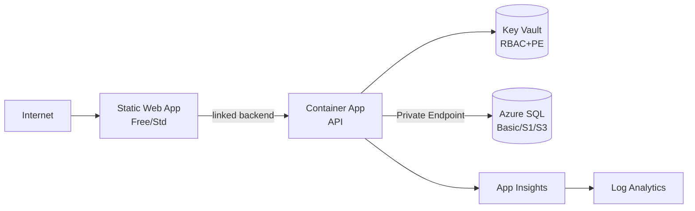

# Skill: Design Landing Zone (Azure)

Skill prescriptiva para producir el brief de arquitectura. **No genera `.tf`** — solo el contrato y la decisión.

## Cloud asumido

Azure. Provider `azurerm ~> 4.0`. Servicios canónicos del repo:

- **Compute**: Azure Container Apps Environment (CAE).
- **BD**: Azure SQL Database con Private Endpoint.
- **Secretos**: Azure Key Vault (RBAC + Private Endpoint en pre/prod).
- **Frontend estático**: Azure Static Web App.
- **Observabilidad**: Log Analytics Workspace + Application Insights.
- **Identidad**: User-Assigned Managed Identity (UAMI) por app; AAD groups para humanos.
- **DNS**: Azure Private DNS Zones para Private Endpoints.

## Topología canónica

```
Internet  →  Static Web App (público, Free/Std)
                │
                │ linked backend
                ▼
            Container App (API)  ─ UAMI ─→  Key Vault (RBAC + PE)
                │
                │ Private Endpoint
                ▼
            Azure SQL (privada, Basic/S1/S3)

Observabilidad: Log Analytics + App Insights atados.
Red: VNet /16 con subnets cae(/23), sql(/28), pe(/28). NSGs deny por defecto.
```

## Diferencias por entorno (tabla obligatoria en el brief)

| | dev | pre | prod |
|---|---|---|---|
| SKU SQL | Basic | S1 | S3 / BC |
| Backup days | 7 | 14 | 35 |
| Static Web App | Free | Standard | Standard |
| KV Private Endpoint | opcional | sí | sí |
| KV soft delete + purge | sí (90d) | sí (90d) | sí (90d) |
| Log retention | 30d | 60d | 365d |
| Alert 5xx threshold | 10% | 5% | 1% |
| Latencia p95 alert | 2000ms | 1000ms | 500ms |
| `prevent_destroy` SQL/KV/SWA | no | sí | sí |
| AAD admin SQL obligatorio | sí | sí | sí |
| `azurerm` backend | local | remote | remote |
| Required reviewers en GH Env | no | opcional | **sí** |

## Pasos para producir el brief

### 1. Resumen ejecutivo (3-5 líneas)

Qué se construye, para qué, restricciones críticas.

### 2. Diagrama Mermaid



### 3. Decisiones de arquitectura

Tabla `decisión | rationale | alternativa descartada`:

| Decisión | Rationale | Alternativa descartada |
|---|---|---|
| CAE en lugar de AKS | Menor superficie operativa para una API stateless | AKS (overkill para 1 servicio) |
| KV con RBAC, no access policies | Modelo moderno, IAM consistente | Access policies (deprecated) |
| Static Web App vs App Service | SWA tiene CDN + integración con GitHub Actions out-of-the-box | App Service + Front Door (más caro) |
| ... | ... | ... |

### 4. Inputs / outputs de cada módulo (contrato)

Sin escribir Terraform, lista qué expone cada módulo:

- **network** outputs: `resource_group_name`, `vnet_id`, `subnet_cae_id`, `subnet_sql_id`, `subnet_pe_id`.
- **database** outputs: `sql_server_fqdn`, `sql_database_name`, `administrator_login`.
- **secrets** outputs: `sql_admin_password_secret_id`.
- **compute** outputs: `container_app_id`, `api_uami_principal_id`.
- **observability** outputs: `log_analytics_workspace_id`, `application_insights_connection_string`.
- **frontend** outputs: `static_web_app_default_hostname`.
- **iam** outputs: role assignments (no resources outputs típicos).

### 5. Inputs requeridos de cada env

- `subscription_id` (variable).
- `project_name`.
- `environment` (dev | pre | prod).
- `location` (westeurope por defecto).
- `azuread_admin_login`, `azuread_admin_object_id`.
- `ops_group_object_id`, `readonly_group_object_id`, `ci_principal_object_id`.

### 6. Riesgos y mitigaciones

| Riesgo | Mitigación | Propietario |
|---|---|---|
| Leak de SQL password | random_password + KV + UAMI + role mínimo | terraform-engineer |
| Pérdida accidental de KV | soft delete + purge protection + prevent_destroy | terraform-engineer |
| Costes runaway en prod | SKU fijo + budget alert + revisión mensual | platform-team |
| AAD admin único | Asignar grupo, no usuario; rotación documentada | seguridad |

### 7. Requisitos para terraform-engineer

Lista clara de módulos a crear/modificar y variables nuevas.

### 8. Pendientes humanos

- Service Principal para CI (federated credentials con GH).
- Crear AAD groups `<project>-ops`, `<project>-readonly`.
- Dominios custom / certificados ACME / WAF (si aplica).
- Creación manual del Storage Account de tfstate.

## Reglas duras

- **Producción siempre con aprobación humana** (deploy.yml + Required reviewers).
- **BD privada por defecto** — `public_network_access_enabled = false` en pre/prod.
- **Secretos en Key Vault** — nunca en variables Terraform de entorno con valor literal.
- **Mínimo privilegio** — roles built-in `Owner`/`Contributor` para apps están prohibidos.
- **Sin `0.0.0.0/0` en NSGs inbound** salvo exigencia documentada (WAF público + Cloudflare/Front Door upstream).
- **TLS 1.2 mínimo**, HTTPS-only.

## Anti-patrones

- Diseñar con un solo entorno "prod-like" — saltar dev/pre quita gates.
- KV con access policies en vez de RBAC.
- BD pública con firewall rules — siempre Private Endpoint en prod.
- Service Principal con `Owner` a la subscription — usar federated credentials + role custom.
- Diseñar sin tabla de diferencias por entorno.
- Resumir el brief sin Mermaid ni decisiones explícitas.
