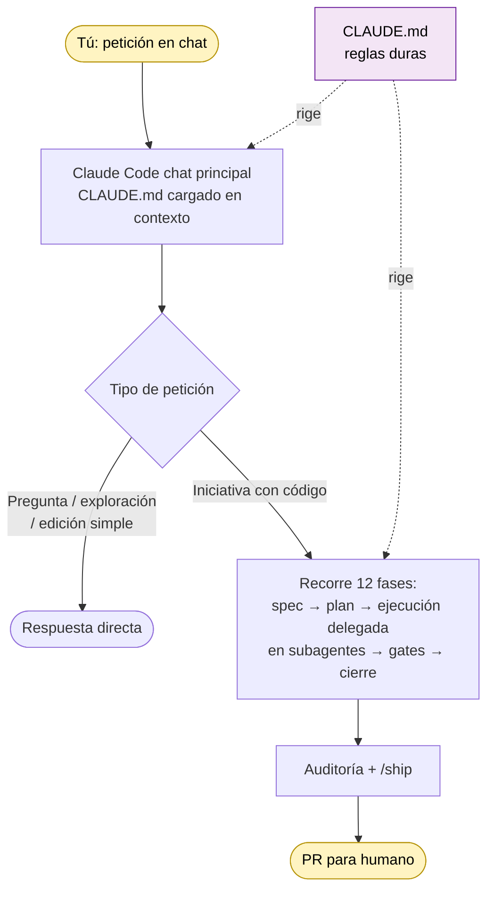
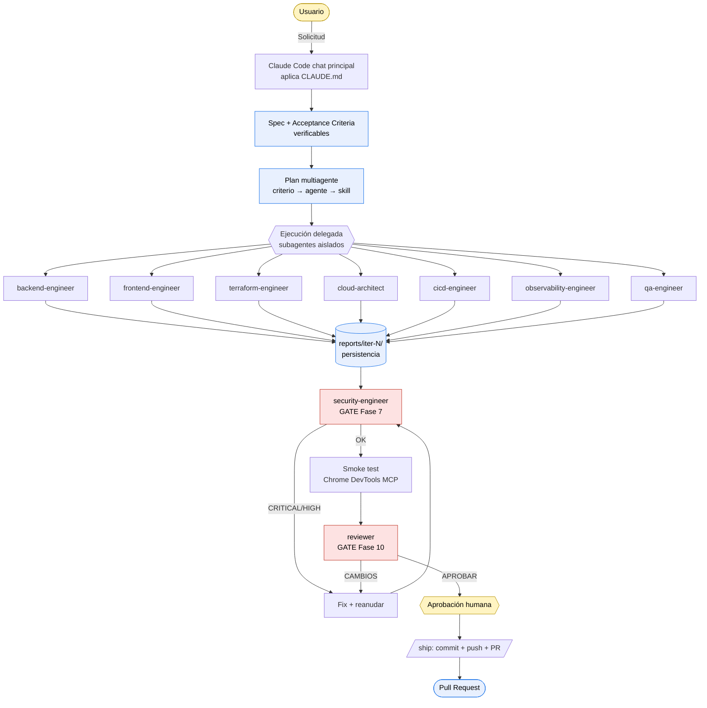
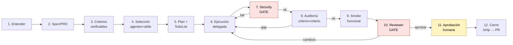
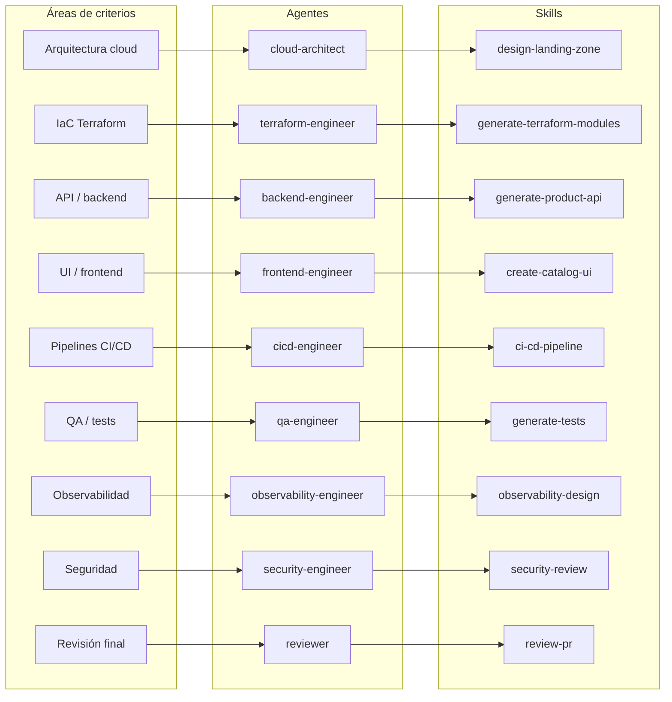
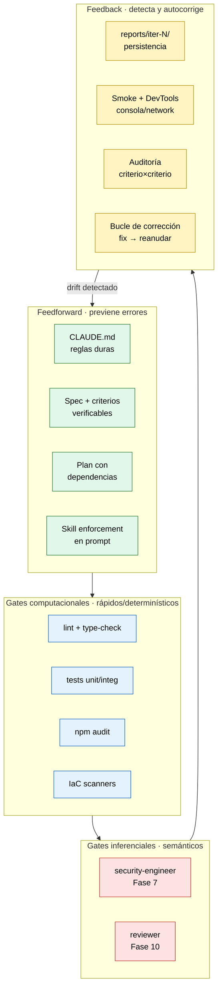

# ADLC Claude Code Workspace

Plantilla de workspace para Claude Code orientada a un **Agentic Development Lifecycle (ADLC)**, **Spec-Driven Development (SDD)** y **Harness Engineering**.

> Un agente solo es tan bueno como el *harness* que lo rodea: especificaciones verificables, gates automáticos, revisores independientes y bucles de feedback. Este repo es un harness reutilizable, no un agente suelto.

---

## Estructura

```text
CLAUDE.md                                        # Manual completo del flujo ADLC (siempre en contexto)
README.md                                        # Este documento

.claude/
  settings.local.json                            # Permisos locales de Claude Code
  agents/                                        # Subagents (Markdown + YAML frontmatter)
    cloud-architect.md                           # Topología cloud, IAM, red
    terraform-engineer.md                        # Módulos IaC
    backend-engineer.md                          # APIs y lógica de negocio
    frontend-engineer.md                         # UI / catálogo
    cicd-engineer.md                             # Pipelines y despliegues
    qa-engineer.md                               # Estrategia y tests
    security-engineer.md                         # GATE Fase 7
    observability-engineer.md                    # Logs, métricas, trazas, SLOs
    reviewer.md                                  # GATE Fase 10 (auditoría independiente)
  skills/                                        # Skills (cada una con su SKILL.md)
    create-prd/SKILL.md                          # PRD verificable
    plan-agentic-work/SKILL.md                   # Plan multiagente
    design-landing-zone/SKILL.md                 # Diseño de landing zone
    generate-terraform-modules/SKILL.md          # Módulos Terraform
    generate-product-api/SKILL.md                # API de catálogo
    create-catalog-ui/SKILL.md                   # UI de catálogo
    ci-cd-pipeline/SKILL.md                      # Pipelines CI/CD
    generate-tests/SKILL.md                      # Tests unit/integ/E2E
    security-review/SKILL.md                     # Revisión de seguridad
    observability-design/SKILL.md                # Diseño de observabilidad
    review-pr/SKILL.md                           # Checklist de auditoría final
  commands/                                      # Slash commands
    ship.md                                      # /ship: cierre + PR con evidencias

specs/                                           # Especificaciones (fuente de verdad operativa)
  computer-catalog-landing-zone-prd.md           # PRD del caso de uso
  acceptance-criteria.md                         # Criterios verificables (checkboxes por iteración)
  qa-strategy.md                                 # Estrategia de pruebas
  iter-5-backlog.md                              # Backlog vivo entre iteraciones

scripts/
  validate_claude_workspace.py                   # Valida frontmatter y estructura del workspace

docs/
  harness-engineering.md                         # Notas internas sobre el harness

reports/iter-<N>/                                # Reportes persistidos por iteración (auditoría retrospectiva)

apps/                                            # Código de aplicación de demo (catálogo de discos heavy metal)
  api/                                           # Fastify + TypeScript + Vitest
  web/                                           # Next.js 15 + React 19 + Tailwind + Playwright
infra/                                           # IaC (Terraform + azurerm)
```

> **Nota sobre el manual.** El flujo ADLC completo (las 12 fases, reglas duras, anti-patrones, output esperado) vive en `CLAUDE.md` y se inyecta siempre en el contexto. **Claude principal orquesta directamente**; no existe un agente "orquestador" dedicado. La práctica entre iter-4 e iter-7 demostró que delegar la orquestación a un subagente aislado añade overhead (sandbox sin Bash, sin tool `Agent` para sub-sub-agentes, doble redacción de prompts) sin valor proporcional. Los subagentes ejecutores especializados (`backend-engineer`, `frontend-engineer`, `qa-engineer`, `security-engineer`, `reviewer`) sí aportan valor y se invocan caso a caso.

---

## Cómo usarlo

1. Descomprime/clona el repositorio.
2. Abre Claude Code en esa carpeta. `CLAUDE.md` se carga automáticamente como manual.
3. Ejecuta `/agents` para comprobar los subagents disponibles.
4. Ejecuta `/skills` para comprobar las skills disponibles.
5. Lanza una iniciativa. Ejemplos:

   ```text
   # Iniciativa nueva grande (PRD desde cero, varios componentes):
   Quiero una landing zone cloud para un catálogo de productos. Plan completo: PRD,
   criterios verificables, IaC, backend, frontend, CI/CD, observabilidad, seguridad.

   # Cambio acotado en algo que ya existe:
   Añade un filtro por género al listado de discos, end-to-end con tests y smoke.
   ```

   En cualquier caso Claude principal aplica las 12 fases del manual `CLAUDE.md` y delega en subagentes ejecutores especializados (`backend-engineer`, `frontend-engineer`, `qa-engineer`, `security-engineer`, `reviewer`) según el área.

Validación local de la plantilla:

```bash
python scripts/validate_claude_workspace.py
```

---

## Sistema de orquestación: cómo funciona

### Quién hace qué (dos planos)

Solo hay dos actores en el flujo:

| Plano | Quién | Qué hace | Cuándo entra |
|---|---|---|---|
| **Manual** | `CLAUDE.md` | Contiene **las 12 fases completas**, reglas duras, anti-patrones y output esperado. Es el manual operativo del flujo ADLC. No ejecuta nada. | Siempre en contexto — Claude Code lo carga automáticamente en cada conversación dentro del repo. |
| **Orquestador** | Claude Code en el chat principal | Aplica el manual íntegramente: planifica, delega en subagentes ejecutores especializados, audita reportes, lanza gates obligatorios, cierra con `/ship`. | Cada vez que escribes algo. |

> **Punto clave:** **no existe un agente "orquestador" dedicado**. La práctica entre iter-4 e iter-7 demostró que delegar la orquestación a un subagente aislado (sandbox sin Bash, sin tool `Agent` para sub-sub-agentes) añade overhead sin valor proporcional. Claude principal orquesta directamente porque el manual ya vive en su contexto.

### Flujo desde tu petición hasta el PR



**Cómo se invoca cada actor:**

- `CLAUDE.md` → automático. No haces nada. Su contenido se inyecta como contrato del proyecto.
- Chat principal → tu mensaje en el prompt.
- Subagentes ejecutores (`backend-engineer`, `frontend-engineer`, `qa-engineer`, `security-engineer`, `reviewer`, etc.) → el chat principal los delega con `Agent({ subagent_type: ..., prompt: ... })` cuando hay trabajo en un dominio concreto. Cada subagente trabaja en contexto aislado con skills declaradas en su frontmatter.
- Skills → las invoca el subagente activo con la tool `Skill`. El prompt del subagente debe pedir la skill explícitamente y exigir que el reporte abra con `## Skills ejecutadas`.
- `/ship` → lo escribes tú al final, no se dispara solo.

> `security-engineer` (Fase 7) y `reviewer` (Fase 10) son **obligatorios en TODA iteración**. El reviewer aporta el valor de "ojos frescos" que detecta bugs semánticos que se le escapan al ejecutor.

### Vista general del flujo



### Capas del harness

| Capa | Qué hace | Dónde vive |
|---|---|---|
| **Spec (feedforward)** | Define objetivo, alcance y criterios *verificables* antes de generar código. | `specs/<slug>-prd.md`, `specs/acceptance-criteria.md` |
| **Plan (feedforward)** | Mapea criterios → agentes → skills → tareas → dependencias. | TodoList de Claude principal + skill `plan-agentic-work` |
| **Ejecución (delegada)** | Subagentes aislados con prompts autocontenidos. Cada uno declara qué Skill ejecuta. | Agentes en `.claude/agents/`, skills en `.claude/skills/` |
| **Gates computacionales** | `npm audit`, linters, type-check, tests, escáneres IaC. Determinísticos y baratos. | Workflows CI + scripts |
| **Gates inferenciales** | `security-engineer` (Fase 7) + `reviewer` independiente (Fase 10). | Subagentes obligatorios |
| **Persistencia / trazabilidad** | Cada agente guarda su reporte en `reports/iter-<N>/<agente>.md`. | `reports/` |
| **Cierre humano** | `/ship` reutiliza el reporte del reviewer si está fresco; abre PR. Aprobación humana = único merge. | `.claude/commands/ship.md` |

### Las 12 fases en secuencia



### Las 12 fases del flujo ADLC

1. Entender la solicitud (resumen + supuestos, una tanda de preguntas).
2. Spec / PRD verificable.
3. Criterios de aceptación con comando/test que los valide.
4. Selección de agentes y skills (mapa criterio → agente).
5. Plan con TodoList y dependencias.
6. Ejecución delegada con **skill enforcement** (el subagente debe listar `Skills ejecutadas`).
7. **Security gate** (`security-engineer` + skill `security-review`). CRITICAL/HIGH bloquean.
8. Auditoría criterio por criterio con tabla `criterio | evidencia | estado`.
9. **Smoke test funcional** (Chrome DevTools MCP, consola, network) si hay app ejecutable.
10. **Reviewer independiente** (`reviewer` + skill `review-pr`). Veredicto APROBAR / CAMBIOS / RECHAZAR.
11. Aprobación humana para decisiones de blast radius alto.
12. Cierre con `/ship` (commit + push + PR con tabla de evidencias).

Reglas duras (extracto de `CLAUDE.md`):

- **Nunca cerrar sin auditar criterios uno a uno.**
- **Security gate y reviewer no son opcionales**, ni siquiera en demos.
- **Marca solo los checkboxes verificados.** Mejor cierre honesto con 2 gaps que cierre falso con 0.
- **No despliegues a producción.** Eso lo hace un humano.

---

## Cómo debo pedir cosas

El workspace responde mejor a peticiones que dejan claros tres elementos: **objetivo**, **alcance** y **evidencia esperada**. No hace falta plantilla rígida; sí hace falta intención.

### Patrón recomendado

```text
[Objetivo] Quiero <X> para <para qué / quién>.
[Alcance] Incluye <A, B>. No incluye <C>.
[Restricciones] <stack, cloud, políticas, datos>.
[Evidencia] Cuando termines, quiero ver <test que pasa | endpoint vivo | captura | tabla de criterios>.
[Cierre] Aplica el flujo ADLC de CLAUDE.md (o invoca solo el agente <nombre> si únicamente necesito esta pieza).
```

### Niveles de petición

| Nivel | Cuándo usarlo | Cómo se ejecuta |
|---|---|---|
| **Full ADLC** | Iniciativa nueva, varios componentes, requiere gobernanza. | Claude principal recorre las 12 fases delegando en subagentes ejecutores. |
| **Skill puntual** | Un entregable concreto en un dominio bien acotado. | El agente del dominio + su skill, invocado por Claude principal. |
| **Revisión / cierre** | Trabajo hecho que hay que auditar y enviar. | `reviewer` → `/ship`. |
| **Pregunta / exploración** | Entender el repo, comparar opciones, no producir artefacto. | Conversación directa o agente `Explore`. |

### Anti-patrones a evitar al pedir

- "Hazlo rápido y luego pulimos." → Spec ambigua = trabajo que falla en la auditoría.
- "Saltémonos el reviewer, es solo una demo." → Security y reviewer son **siempre** obligatorios.
- "Marca todos los criterios como hechos." → Claude principal rechazará el cierre y dejará rojos los no verificados.
- "Que el agente decida qué skill usar." → Indica explícitamente la skill esperada en el prompt del subagente.

---

## Cómo se activan agentes y skills en el ciclo completo

Los agentes se invocan vía la herramienta `Agent` con `subagent_type=<nombre>`. Las skills se invocan vía la herramienta `Skill` con `skill: <nombre>`. Cada agente declara en su frontmatter qué skills puede ejecutar; Claude principal **pide explícitamente** la skill esperada en el prompt y exige que el reporte del subagente abra con una sección `## Skills ejecutadas`.

### Catálogo

**Agentes** (`.claude/agents/`)

| Agente | Cuándo se activa | Skills declaradas |
|---|---|---|
| `cloud-architect` | Decisiones de arquitectura cloud antes de IaC. | `design-landing-zone` |
| `terraform-engineer` | Crear/validar módulos IaC. | `generate-terraform-modules` |
| `backend-engineer` | APIs, modelos, lógica de negocio, conexión a BD. | `generate-product-api` |
| `frontend-engineer` | UI catálogo, landing, filtros, buscador, responsive. | `create-catalog-ui` |
| `cicd-engineer` | Pipelines, gates, despliegues por entorno. | `ci-cd-pipeline` |
| `qa-engineer` | Estrategia y tests (unit, integración, API, E2E). | `generate-tests` |
| `security-engineer` | Gate Fase 7: deps, IaM, IaC, secretos, contenedores. | `security-review` |
| `observability-engineer` | Logs, métricas, trazas, dashboards, SLOs, alertas. | `observability-design` |
| `reviewer` | Auditoría final independiente antes de aprobación humana. | `review-pr` |

**Skills** (`.claude/skills/`): `create-prd`, `plan-agentic-work`, `design-landing-zone`, `generate-terraform-modules`, `generate-product-api`, `create-catalog-ui`, `ci-cd-pipeline`, `generate-tests`, `security-review`, `observability-design`, `review-pr`.

### Mapa visual: criterio → agente → skill



**Slash command**: `/ship [titulo]` — reutiliza el reporte del reviewer si está fresco (≤2h, sin commits posteriores tocando `apps|infra|specs`, veredicto APROBAR) o lanza uno nuevo, comprueba que no hay secretos/artefactos staged, commitea, pushea y abre PR. No usa `--force`, `--amend` ni `--no-verify`. No mergea.

### Mapa criterio → agente → skill (referencia)

| Área de criterios | Agente | Skill |
|---|---|---|
| Arquitectura / topología cloud | `cloud-architect` | `design-landing-zone` |
| IaC (Terraform) | `terraform-engineer` | `generate-terraform-modules` |
| API / backend | `backend-engineer` | `generate-product-api` |
| UI / frontend | `frontend-engineer` | `create-catalog-ui` |
| Pipelines / despliegue | `cicd-engineer` | `ci-cd-pipeline` |
| QA / tests | `qa-engineer` | `generate-tests` |
| Observabilidad | `observability-engineer` | `observability-design` |
| Seguridad (gate Fase 7) | `security-engineer` | `security-review` |
| Auditoría final (Fase 10) | `reviewer` | `review-pr` |

### Modo aislado (decisión arquitectónica)

Los subagentes se lanzan **sin team**: no se ven entre sí, no se mandan mensajes. Claude principal es el único punto de coordinación. Para trabajo en paralelo sobre archivos compartidos, declara contratos (slots, comentarios `{/* aquí va X */}`) o serializa. Esto es **intencional**: garantiza que `security-engineer` y `reviewer` opinen con ojos frescos.

---

## Ejemplos: qué se activa y por qué

### Ejemplo 1 — Iniciativa nueva (full ADLC)

> "Quiero una landing zone cloud que aloje un catálogo de productos de tienda de ordenadores con backend, frontend, CI/CD, observabilidad y seguridad. Stack libre, target Azure o AWS, pendiente de decisión humana."

Activaciones:

1. Claude principal recorre las fases 1-12 del manual `CLAUDE.md`.
2. Fase 2-3 → skill `create-prd` produce `specs/<slug>-prd.md` y `specs/acceptance-criteria.md`.
3. Fase 4-5 → skill `plan-agentic-work` produce el plan multiagente.
4. Fase 6 (paralelizable donde no haya conflicto de archivos):
   - `cloud-architect` + `design-landing-zone` → topología, IAM, red.
   - `terraform-engineer` + `generate-terraform-modules` → módulos IaC.
   - `backend-engineer` + `generate-product-api` → API catálogo.
   - `frontend-engineer` + `create-catalog-ui` → UI.
   - `cicd-engineer` + `ci-cd-pipeline` → workflows.
   - `observability-engineer` + `observability-design` → logs/métricas/SLOs.
   - `qa-engineer` + `generate-tests` → tests por área.
5. Fase 7 → `security-engineer` + `security-review`. CRITICAL/HIGH bloquean.
6. Fase 9 → smoke con Chrome DevTools MCP si hay UI.
7. Fase 10 → `reviewer` + `review-pr`.
8. Fase 11 → humano confirma cloud target y deploy.
9. Cierre → `/ship` reutiliza el reporte de `reviewer` si está fresco.

Por qué: la solicitud cubre múltiples dominios y tiene blast radius alto (deploy real); requiere los doce pasos del harness y los dos gates inferenciales.

### Ejemplo 2 — Cambio acotado en una sola pieza

> "Añade un endpoint `GET /products/:id` con tests."

Activaciones:

1. `backend-engineer` + `generate-product-api` → implementación + tests.
2. `qa-engineer` + `generate-tests` → cobertura del nuevo endpoint.
3. `security-engineer` + `security-review` (gate obligatorio, aunque breve).
4. `reviewer` + `review-pr` (siempre).
5. `/ship` para abrir PR.

Por qué: aunque sea pequeño, las reglas duras de `CLAUDE.md` no admiten saltarse security ni reviewer. Claude principal puede no necesitar recorrer las 12 fases con la misma intensidad, pero los gates inferenciales se mantienen.

### Ejemplo 3 — Revisar trabajo ya hecho

> "Revisa lo que llevo en esta rama y dime si está listo para PR."

Activaciones:

1. `reviewer` + `review-pr` audita contra `specs/acceptance-criteria.md`, comprueba evidencias, riesgos y calidad.
2. Si veredicto = APROBAR y reporte fresco → `/ship` lo reutiliza al crear el PR.
3. Si veredicto = CAMBIOS → tareas de corrección y reanudación del agente correspondiente, **no** `/ship`.

Por qué: el reviewer es el último filtro antes del humano. `/ship` está diseñado para reutilizar su reporte y evitar doble auditoría cuando es seguro.

### Ejemplo 4 — Solo infraestructura

> "Necesito los módulos Terraform para red y BD privada de la landing zone, sin tocar la app."

Activaciones:

1. `cloud-architect` + `design-landing-zone` (si la topología aún no está fijada).
2. `terraform-engineer` + `generate-terraform-modules`.
3. `security-engineer` + `security-review` (exposición pública, IAM, secretos, deletion_protection, encryption at rest).
4. `reviewer` + `review-pr`.
5. Aprobación humana antes de cualquier `terraform apply` real.

Por qué: IaC es alto riesgo. El gate de seguridad sobre IaC es específicamente uno de los focos de `security-review`.

### Ejemplo 5 — Exploración / pregunta

> "¿Cómo está organizado este repo? ¿Qué agentes hay y para qué sirven?"

Activaciones: ninguna del catálogo ADLC. Conversación directa o, si la búsqueda es amplia, agente `Explore` (read-only).

Por qué: no hay artefacto que producir, no hay criterio que cumplir. Aplicar las 12 fases sería sobrecarga.

---

## Relación con Harness Engineering (Fowler)

Este workspace adopta las prácticas descritas en [Harness Engineering](https://martinfowler.com/articles/harness-engineering.html) de forma explícita. La idea base — *Agent = Model + Harness*, con feedforward (guías que previenen errores) y feedback (sensores que los detectan) — es la columna del repo.

| Práctica de Harness Engineering | Cómo se materializa aquí |
|---|---|
| **Especificaciones verificables como feedforward** | `specs/<slug>-prd.md` + `specs/acceptance-criteria.md`, donde **cada criterio exige comando/test/inspección reproducible**. Skill `create-prd` lo enforza. |
| **Gates computacionales (rápidos, determinísticos)** | `npm audit --audit-level=high`, type-check, lint, tests unitarios e integración, escáneres IaC en `ci-cd-pipeline`. |
| **Gates inferenciales (caros, semánticos)** | `security-engineer` (Fase 7) y `reviewer` (Fase 10) como subagentes obligatorios e independientes. |
| **Controles "a la izquierda" del ciclo** | Spec antes de planificar, plan antes de ejecutar, plan-mode en agentes críticos (`permissionMode: plan`), skill enforcement en el prompt del subagente. |
| **Review agents como retroalimentación semántica** | `reviewer` con skill `review-pr` produce veredicto APROBAR / CAMBIOS / RECHAZAR + lista accionable. Bucle de corrección hasta APROBAR. |
| **Feedback loops con instrucciones de autocorrección** | Reglas duras de `CLAUDE.md` indican qué hacer cuando un subagente reporta sin evidencia: *"recházalo y reanúdalo"*. Claude principal no se conforma con "lo hice". |
| **Monitoreo de drift / observabilidad de agentes** | `reports/iter-<N>/<agente>.md` persiste cada reporte. Skill enforcement obliga a la sección `## Skills ejecutadas`. Auditoría retrospectiva posible. |
| **Harness templates por topología** | Bundles agente+skill por dominio (catálogo, IaC, pipelines, observabilidad) reutilizables entre iteraciones. |
| **Steering humano iterativo** | Aprobación humana en Fase 11. `/ship` no mergea ni hace deploy. Decisiones de blast radius alto no se actúan en nombre del humano. |
| **Separación humano-máquina explícita** | `CLAUDE.md` declara: el humano aprueba, el agente no descubre vulnerabilidades por sí solo; el reviewer no puede ser el mismo que el implementador. |

### Feedforward vs feedback en el ciclo



**Diferencias deliberadas** respecto al artículo: aquí el harness está expresado como artefactos versionados (`.claude/agents/`, `.claude/skills/`, `CLAUDE.md`, `specs/`) en vez de como código de andamiaje. Esto permite que el harness evolucione con PRs revisables, no como configuración opaca.

---

## Caso de uso incluido

> Crear una landing zone cloud para alojar una aplicación de catálogo de productos de una tienda de ordenadores.

Cubre orquestación ADLC, arquitectura cloud, Terraform/IaC, backend API, frontend catálogo, CI/CD, QA, seguridad, observabilidad y revisión final.

### Demo construida sobre el harness

Como banco de pruebas del flujo, el repo incluye una aplicación funcional que se ha ido construyendo iteración a iteración:

| Iteración | Entregable | Evidencia |
|---|---|---|
| iter-1/2 | PRD + landing zone + IaC Azure (`infra/`) | `specs/computer-catalog-landing-zone-prd.md`, módulos Terraform |
| iter-3 | Catálogo de **20 discos heavy metal** (Iron Maiden, Metallica, Black Sabbath, Slayer, Dream Theater…) con API Fastify + UI Next.js + carrito persistente | `apps/api/`, `apps/web/`, 17 tests E2E |
| iter-4 | **Sección de crítica multi-sección** en cada ficha de disco: contexto histórico, sonido, legado, highlights, puntuación y citas de AllMusic / Wikipedia / Rolling Stone con `rel="noopener noreferrer"` | `apps/api/src/data/album-reviews.ts`, `reports/iter-4/` |
| iter-5 | **Filtro por género** con chips interactivos (`role="group"`, `aria-pressed`, debounce 250ms) y deuda procedimental corregida retrospectivamente | `apps/web/components/albums-grid.tsx`, `reports/iter-5/` |

Estado actual: **102/102 tests vitest** (backend) + **28/28 tests Playwright** (frontend, con `--workers=1`). 0 HIGH/CRITICAL en `npm audit`. Reviewer ha firmado APROBAR en iter-4 e iter-5.

Para correrla en local:

```bash
cd apps/api && npm run dev        # API en :4000
cd apps/web && npm run dev        # Next.js en :3000
```

Y visita `http://localhost:3000/albums`.

## Nota

Esta plantilla **no despliega infraestructura real**. Es un punto de partida gobernado: especificaciones, agentes, skills, validaciones, criterios de aceptación y puntos de aprobación humana. El paso a producción es siempre decisión humana explícita.
