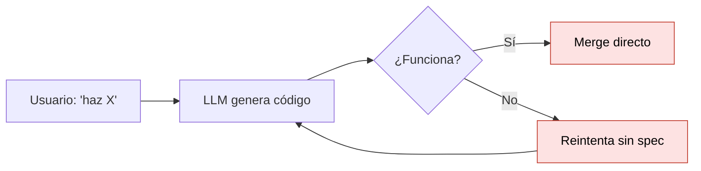
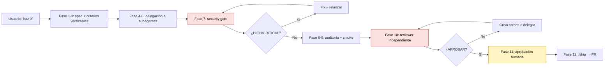
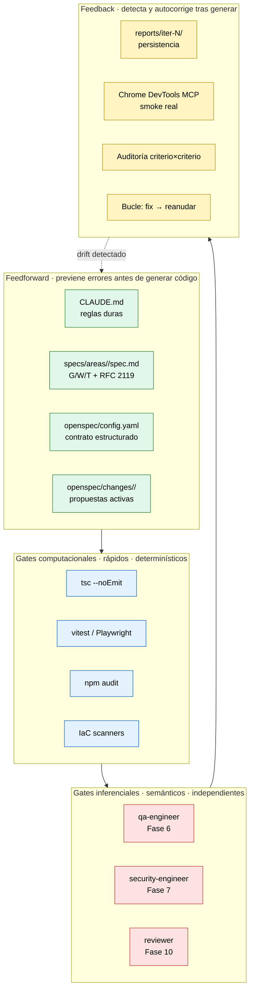
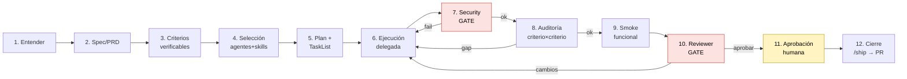
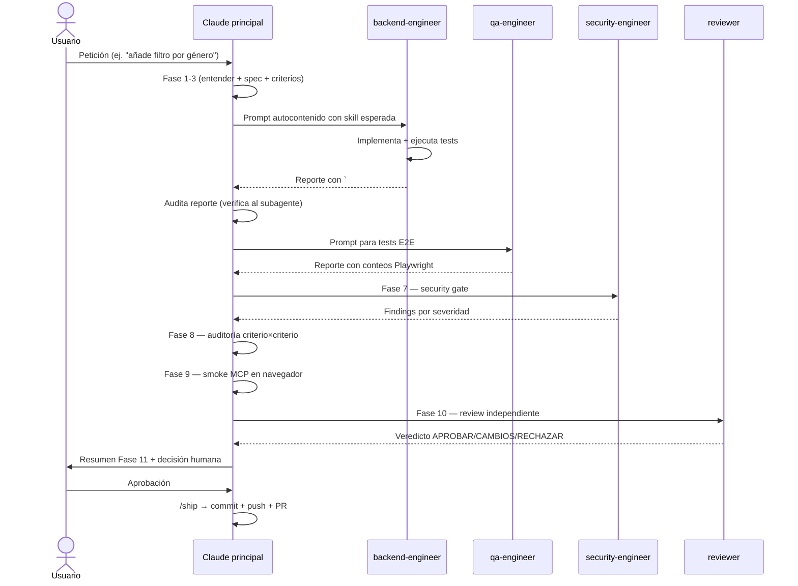
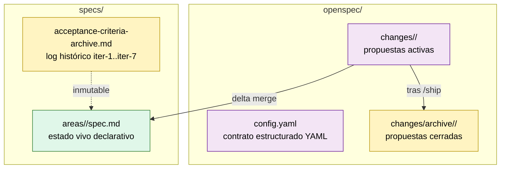
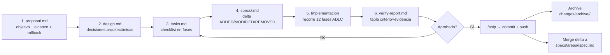
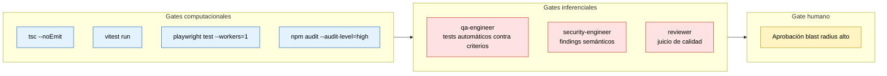
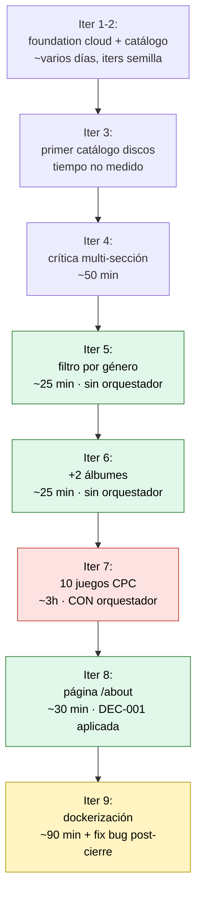
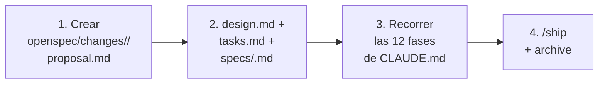

# ADLC Workflow — Cómo construimos software guiado por especificaciones con agentes

> **Audiencia:** equipos y clientes que evalúan el enfoque
> Agentic Development Lifecycle (ADLC) / Spec-Driven Development (SDD)
> sobre Claude Code.
>
> **Qué encontrarás aquí:** el flujo completo desde "el usuario pide algo"
> hasta "el PR está abierto", con diagramas, decisiones arquitectónicas
> (DEC-001/002/003), métricas reales de 8 iteraciones cerradas y las
> lecciones aprendidas que ahora forman parte del manual.
>
> **Tiempo de lectura:** ~25 minutos.

---

## Tabla de contenidos

1. [Resumen ejecutivo](#1-resumen-ejecutivo)
2. [El problema que resuelve ADLC](#2-el-problema-que-resuelve-adlc)
3. [Arquitectura del workspace](#3-arquitectura-del-workspace)
4. [Las 12 fases del flujo ADLC](#4-las-12-fases-del-flujo-adlc)
5. [Subagentes especializados](#5-subagentes-especializados)
6. [Skills: bloques reutilizables](#6-skills-bloques-reutilizables)
7. [El contrato `openspec/`](#7-el-contrato-openspec)
8. [Gates obligatorios e inferenciales](#8-gates-obligatorios-e-inferenciales)
9. [Historial de decisiones (DEC-001/002/003)](#9-historial-de-decisiones)
10. [Caso de uso real: iter-8 paso a paso](#10-caso-de-uso-real-iter-8-paso-a-paso)
11. [Métricas reales de 8 iteraciones](#11-métricas-reales-de-8-iteraciones)
12. [Anti-patrones a evitar](#12-anti-patrones-a-evitar)
13. [Cómo empezar en un proyecto nuevo](#13-cómo-empezar-en-un-proyecto-nuevo)

---

## 1. Resumen ejecutivo

ADLC es un flujo de desarrollo donde **cada cambio de software pasa
obligatoriamente por 12 fases verificables**, ejecutadas por un agente
LLM principal que delega trabajo en subagentes especializados y se
valida con gates automáticos y humanos.

**Principios fundamentales:**

- **Trabajar siempre contra una especificación explícita**, no contra
  ideas vagas en chat.
- **Criterios de aceptación verificables** mediante comando, test o
  inspección reproducible (Given/When/Then + RFC 2119 desde iter-8).
- **Subagentes con contextos aislados** y skills declaradas.
- **Tres subagentes obligatorios en TODA iteración** (incluido refactor,
  devops, dockerización): `qa-engineer` (Fase 6), `security-engineer`
  (Fase 7) y `reviewer` (Fase 10). No se saltan nunca, ni en demos, ni
  en iters de pura infraestructura.
- **Aprobación humana obligatoria** para acciones de blast radius alto.
- **Trazabilidad versionada en Git**: specs, reportes, decisiones y
  capturas viven como artefactos auditables.

**Resultados a fecha de iter-8:**

| Indicador | Valor |
|---|---|
| Iteraciones cerradas | 9 |
| Tests backend (vitest) | 233/233 verde |
| Tests E2E (Playwright) | 46/46 verde |
| Vulnerabilidades HIGH/CRITICAL en producción | 0 |
| Regresiones acumuladas | 0 |
| Decisiones arquitectónicas trazables | 3 (DEC-001..003) |

---

## 2. El problema que resuelve ADLC

### El anti-patrón típico con LLMs



Problemas:

- Sin spec: el éxito es subjetivo. ¿"Funciona" para qué casos?
- Sin gates: vulnerabilidades, regresiones, deuda técnica entran sin filtro.
- Sin trazabilidad: nadie sabe por qué se decidió lo que se decidió.
- Sin verificación independiente: el LLM aprueba su propio trabajo.

### Cómo lo resuelve ADLC



Cada caja del diagrama tiene una salida verificable. Si una falla, se
reanuda explícitamente. Nada se aprueba por inercia.

---

## 3. Arquitectura del workspace

### Capas del harness



### Estructura del repositorio

```text
CLAUDE.md                        # Manual operativo (siempre en contexto)
README.md                        # Documentación pública del workspace
docs/
  adlc-workflow.md               # Este documento
  harness-engineering.md         # Notas internas

.claude/
  agents/                        # 9 subagentes con frontmatter y skills declaradas
    backend-engineer.md
    frontend-engineer.md
    qa-engineer.md
    security-engineer.md
    reviewer.md
    cloud-architect.md
    terraform-engineer.md
    cicd-engineer.md
    observability-engineer.md
  skills/                        # 11 skills reutilizables (cada una con SKILL.md)
  commands/
    ship.md                      # /ship: cierre + PR con evidencias

openspec/
  config.yaml                    # Datos operativos (tech stack + testing + history.decisions)
  README.md
  changes/
    README.md                    # Ciclo de vida de un change
    <slug>/                      # Cada propuesta activa
      proposal.md
      design.md
      tasks.md
      verify-report.md
      specs/<area>.md            # Delta ADDED/MODIFIED/REMOVED

specs/
  areas/                         # Specs vivos por dominio (G/W/T + RFC 2119)
    platform/spec.md
    infra-azure/spec.md
    catalog-products/spec.md
    albums/spec.md
    games/spec.md
  acceptance-criteria-archive.md # Histórico inmutable iter-1..iter-7
  <slug>-prd.md                  # PRDs originales

reports/
  iter-<N>/                      # Reportes por iteración + capturas smoke
    backend-engineer.md
    frontend-engineer.md
    qa-engineer.md
    security-engineer.md
    reviewer.md
    smoke-*.png

apps/                            # Código de aplicación
  api/                           # Fastify 5 + TypeScript + Vitest
  web/                           # Next.js 15 + React 19 + Playwright

infra/                           # IaC Terraform (Azure)

scripts/
  validate_claude_workspace.py   # Valida frontmatter y estructura
```

### Tres planos del flujo

| Plano | Quién | Qué hace | Cuándo entra |
|---|---|---|---|
| **Manual** | `CLAUDE.md` + `openspec/config.yaml` | Manual operativo (prosa + estructura). No ejecuta nada. | Siempre en contexto. |
| **Orquestador** | Claude Code en el chat principal | Aplica el manual íntegro: planifica, delega, audita, lanza gates, cierra con `/ship`. | Cada vez que escribes. |
| **Subagentes** | 9 agentes especializados | Ejecutan trabajo en su dominio (backend, frontend, QA, security…) con skills declaradas y contexto aislado. | Cuando Claude principal los invoca con la tool `Agent`. |

> **No hay agente "orquestador" dedicado.** Probamos uno entre iter-4 e
> iter-7 y se eliminó por aportar overhead sin valor (ver DEC-001).

---

## 4. Las 12 fases del flujo ADLC



### Detalle por fase

| # | Fase | Responsable | Entregable |
|---|---|---|---|
| 1 | Entender | Claude principal | Resumen 1-3 frases + supuestos explícitos. Preguntas en una sola tanda si hay ambigüedad. |
| 2 | Spec/PRD | Claude principal | `specs/<slug>-prd.md` u `openspec/changes/<slug>/proposal.md`. |
| 3 | Criterios verificables | Claude principal | Criterios G/W/T + RFC 2119 en `specs/areas/<area>/spec.md` o delta en `openspec/changes/<slug>/specs/<area>.md`. |
| 4 | Selección de agentes y skills | Claude principal | Mapa criterio → agente → skill. **Tres obligatorios en TODA iteración** (incluido refactor, devops, dockerización, docs): `qa-engineer`, `security-engineer`, `reviewer`. |
| 5 | Plan | Claude principal | TaskList con dependencias. Una tarea por subagente por área. |
| 6 | Ejecución delegada (incluye **qa gate** ⛔) | Subagentes ejecutores, **qa-engineer obligatorio** | Prompts autocontenidos. Skill enforcement. Reportes persistidos en `reports/iter-N/<agente>.md`. El `qa-engineer` debe ejecutarse incluso si no hay cambios de lógica de negocio (lección iter-9). |
| 7 | **Security gate** ⛔ | `security-engineer` + `security-review` | Findings con severidad. CRITICAL/HIGH bloquean. |
| 8 | Auditoría criterio por criterio | Claude principal | Tabla `criterio \| evidencia \| estado`. Solo marcar lo verificado. |
| 9 | Smoke funcional | Claude principal con Chrome DevTools MCP | Capturas + consola + network. Errores son bugs reales. |
| 10 | **Reviewer** ⛔ | `reviewer` + `review-pr` | Veredicto APROBAR / CAMBIOS REQUERIDOS / RECHAZAR. |
| 11 | Aprobación humana | Usuario | Confirmación explícita para blast radius alto. |
| 12 | Cierre | Claude principal vía `/ship` | Commit + push + PR con tabla de evidencias. |

---

## 5. Subagentes especializados

Cada subagente vive en `.claude/agents/<nombre>.md` con un frontmatter
YAML que declara:

```yaml
---
name: backend-engineer
description: Implementa APIs, modelos de datos, lógica de negocio.
tools: Read, Glob, Grep, Bash, Edit, MultiEdit, Write
model: inherit
permissionMode: acceptEdits
maxTurns: 25
skills:
  - generate-product-api
memory: project
---
```

### Catálogo completo

| Agente | Cuándo se activa | Skill principal |
|---|---|---|
| `cloud-architect` | Decisiones de arquitectura cloud antes de IaC | `design-landing-zone` |
| `terraform-engineer` | Crear/validar módulos IaC | `generate-terraform-modules` |
| `backend-engineer` | APIs, modelos, lógica de negocio | `generate-product-api` |
| `frontend-engineer` | UI catálogo, landing, filtros, ficha | `create-catalog-ui` |
| `cicd-engineer` | Pipelines, gates, despliegues | `ci-cd-pipeline` |
| `qa-engineer` ⛔ | **Gate Fase 6**: estrategia y tests (unit, integ, E2E). Obligatorio incluso en iters de infra/devops. | `generate-tests` |
| `security-engineer` ⛔ | **Gate Fase 7**: deps, IAM, IaC, secretos | `security-review` |
| `observability-engineer` | Logs, métricas, trazas, dashboards | `observability-design` |
| `reviewer` ⛔ | **Gate Fase 10**: auditoría final independiente | `review-pr` |

### Decisión arquitectónica: modo aislado

Los subagentes se lanzan **sin team** (sin comunicación entre ellos).
Claude principal es el único punto de coordinación. Esto es intencional:

- Garantiza que `security-engineer` y `reviewer` opinen con **ojos
  frescos**, no contaminados por la narrativa del implementador.
- Si dos agentes deben trabajar sobre archivos compartidos, se
  serializan (uno tras otro) o Claude principal declara contratos
  (slots, comentarios `{/* aquí va X */}`).

### Flujo típico de delegación



---

## 6. Skills: bloques reutilizables

Una **skill** es un módulo de conocimiento procedimental que cualquier
agente puede invocar. Viven en `.claude/skills/<nombre>/SKILL.md` con
un manifest que define cuándo aplica.

### Catálogo de skills

| Skill | Qué hace |
|---|---|
| `create-prd` | Construye un PRD verificable desde una idea de alto nivel |
| `plan-agentic-work` | Descompone una spec en agentes, skills, tareas, dependencias, gates |
| `design-landing-zone` | Diseña una landing zone cloud con red, identidad, observabilidad |
| `generate-terraform-modules` | Genera módulos Terraform seguros y validados |
| `generate-product-api` | Genera API REST de catálogo con tests y documentación |
| `create-catalog-ui` | UI de catálogo de productos con landing, buscador, filtros, ficha |
| `ci-cd-pipeline` | Crea pipelines CI/CD con build, test, gates, deploys por entorno |
| `generate-tests` | Estrategia + tests unit/integ/E2E desde criterios de aceptación |
| `security-review` | Revisa secretos, IAM, exposición pública, dependencias, IaC |
| `observability-design` | Logs, métricas, trazas, dashboards, SLOs, alertas |
| `review-pr` | Revisa entregables contra spec, criterios, tests, seguridad, riesgos |

### Skill enforcement

Cada prompt enviado a un subagente **debe indicar explícitamente** qué
skill ejecutar. El reporte del subagente **debe abrir con**:

```markdown
## Skills ejecutadas
- Skill(skill: "<nombre>") → aplicada
```

Sin esa sección, el orquestador rechaza el reporte y reanuda al
subagente. Esto previene el anti-patrón "el LLM hizo algo razonable
pero no sé cuál fue su lógica".

---

## 7. El contrato `openspec/`

Inspirado en el modelo openspec de
[gentle-ai (Gentleman-Programming)](https://github.com/Gentleman-Programming/gentle-ai),
adoptado en iter-8 (DEC-002).

### Tres archivos clave



### `openspec/config.yaml`

Datos operativos con tres bloques que sí tienen consumidor real
(DEC-004 acotó el alcance):

- `context`: tech stack real del repo. Útil para onboarding rápido
  (~20 líneas leen humano nuevo o sesión fresca del LLM).
- `strict_tdd`: bool honesto (hoy `false`).
- `testing`: capas disponibles (unit, integration, e2e, smoke) con
  comandos exactos y `cwd`. Referencia canónica cuando hace falta
  recordar p.ej. `npx playwright test --workers=1`.
- `history.decisions[]`: registro de decisiones arquitectónicas con
  rationale y commit hash (DEC-001/002/003/004 a fecha de hoy).
  Auditoría retrospectiva.

**Lo que NO contiene** (DEC-004): reglas por fase del flujo ADLC. Esas
viven solo en `CLAUDE.md` para evitar drift. Tuvimos una sección
`rules.*` entre iter-7 e iter-8 que duplicaba CLAUDE.md sin que nadie
la consumiera automáticamente — eliminada en DEC-004.

#### Quién lo lee, cuándo y para qué

Honestamente, hoy es un archivo de **lectura humana o por petición
explícita al LLM**, no procesado automáticamente por ninguna herramienta.

| Consumidor | Cuándo | Para qué |
|---|---|---|
| Humano nuevo en el repo | Al hacer onboarding | Entender tech stack + comandos en 20 líneas, sin leer toda la documentación. |
| Humano con el repo en marcha | Cuando duda de un comando | "¿Era `--workers=1` o `--workers=4`?" → mirar `testing.layers.e2e.command`. |
| Humano auditor / nuevo PM | Cuando necesita contexto histórico | Leer `history.decisions[]` para entender por qué se tomó cada decisión arquitectónica con su commit. |
| Claude principal | Solo si le pides explícitamente "lee openspec/config.yaml" | Refresco rápido del tech stack o de las decisiones pasadas. |
| `scripts/validate_claude_workspace.py` | Nunca (a fecha de iter-8) | Valida agentes y skills, no este archivo. |
| Pipelines CI | Nunca (a fecha de iter-8) | No hay workflow que lo parsee. |

**Conclusión práctica:** úsalo como **referencia rápida** (tech stack,
comandos exactos) y como **log auditable** (decisiones). No esperes
que automatice nada por sí solo. Si en el futuro alguien escribe un
CLI que valide o genere artefactos a partir de él (como hace gentle-ai
con su Go CLI), la estructura YAML ya está preparada para eso.

### Ciclo de vida de un `change`



### Convención G/W/T + RFC 2119

Desde iter-8, todos los criterios nuevos usan este formato:

```markdown
### REQ-<AREA>-<N>: Título corto

Given <contexto inicial>,
when <acción/evento>,
then <resultado verificable>.

- **MUST** / **SHALL** → obligatorio, bloquea cierre.
- **SHOULD** → recomendado, deuda si falla.
- **MAY** → opcional.

**Validación:** <comando | test | inspección>.
```

Esto sustituye los checkboxes vagos del estilo "Buscador funciona" por
contratos que un test puede ejecutar literalmente.

---

## 8. Gates obligatorios e inferenciales

### Tipos de gate



| Característica | Computacionales | Inferenciales | Humano |
|---|---|---|---|
| Coste | Bajo | Alto (LLM extra) | Variable |
| Determinismo | Total | Bajo | N/A |
| Detecta | Errores formales | Bugs semánticos, riesgos | Decisiones de negocio |
| Frecuencia | Cada cambio | Antes de cierre | Antes de blast radius alto |
| Bloquea cierre si falla | Sí | Sí (HIGH/CRITICAL) | Siempre |

### Fase 6 — qa-engineer gate (obligatorio incluso en infra)

`qa-engineer` recorre con la skill `generate-tests`:

- Derivar tests automáticos de los criterios G/W/T + RFC 2119 del spec.
- Implementar tests unitarios (vitest), integración (`fastify
  app.inject`) y E2E (Playwright `--workers=1`) según lo que aplique al
  delta.
- Ejecutar la suite completa y reportar `X passed / Y failed` literal.
- En iters de infraestructura, devops, dockerización o deploy: validar
  que la suite previa **sigue verde contra el nuevo entorno**, no solo
  contra el host de desarrollo (lección DEC-005).

**Lección aprendida iter-9:** este gate era el más fácil de saltarse
porque "no había cambios de lógica". El bug de fichas SSR en Docker
(server components fallaban con ECONNREFUSED) se escapó precisamente
por eso. Desde DEC-005, `qa-engineer` es obligatorio incluso cuando
una iteración no cambia código de negocio.

### Fase 7 — Security gate

`security-engineer` recorre con la skill `security-review`:

- `npm audit --audit-level=high` en cada paquete.
- Grep de secretos (`api[_-]?key`, `token`, `AKIA`, `ghp_`, JWT).
- Validación de input de APIs (Fastify schemas).
- CORS no relajado a `*`.
- `rel="noopener noreferrer"` en enlaces externos.
- Sin `dangerouslySetInnerHTML`.
- Sin nuevas dependencias no declaradas.

**Severidades:**

| Nivel | Acción |
|---|---|
| CRITICAL | Bloquea cierre. Fix obligatorio + relanzar security-engineer. |
| HIGH | Bloquea cierre. Fix obligatorio + relanzar security-engineer. |
| MEDIUM | Documentar como deuda con tarea de seguimiento. |
| LOW | Documentar. |

### Fase 10 — Reviewer

`reviewer` con la skill `review-pr` audita **independientemente**:

- Cumplimiento RF a RF del PRD o delta de spec.
- Calidad del código (legibilidad, patrón, accesibilidad).
- Evidencia de tests (output literal, no paráfrasis).
- Findings del security-engineer (decide si reabre).
- Riesgos no documentados.

**Veredictos:**

| Veredicto | Acción |
|---|---|
| APROBAR | Continuar a Fase 11. |
| APROBAR con observaciones | Continuar; observaciones a backlog. |
| CAMBIOS REQUERIDOS | Crear tareas, delegar, **relanzar reviewer** hasta APROBAR. |
| RECHAZAR | Reanudar en bloque, sentarse con el usuario. |

**Regla dura:** *El reviewer no puede ser quien orquesta*. Debe ser una
instancia independiente.

---

## 9. Historial de decisiones

Decisiones arquitectónicas trazables en `openspec/config.yaml § history.decisions[]`.

### DEC-001 (2026-05-16, commit `c03bcfc`) — Eliminar agente `adlc-orchestrator`

**Contexto:** entre iter-4 e iter-7 existía un agente `adlc-orchestrator` aislado que se invocaba para conducir el flujo ADLC.

**Por qué se eliminó:**

| Coste real medido en iter-7 | Valor real medido |
|---|---|
| 22 rondas de `SendMessage` orquestador↔Claude principal | 1 bug semántico detectado (sorcery.jpg PS3 vs Virgin Games 1984) |
| Doble redacción de prompts (orquestador escribe → Claude principal copia → subagente) | Mismo bug habría detectado el reviewer en Fase 10 |
| Wall-clock ~3 horas | Iter-5 e iter-6 (sin orquestador) cerraron con calidad similar en ~25 min |

**Causa raíz:** el sandbox del subagente orquestador no tenía Bash ni
tool `Agent` (limitación del SDK: subagentes no pueden lanzar
sub-sub-agentes). Claude principal acababa siendo "las manos" en el
100% de los casos.

**Decisión:** el manual operativo (12 fases, reglas duras, anti-patrones)
vive ya en `CLAUDE.md` y se inyecta en contexto cada turno. Claude
principal orquesta directamente; los subagentes ejecutores especializados
(donde sí hay valor real) se invocan caso a caso.

### DEC-002 (2026-05-17, commit `e4d5787`) — Adoptar `specs/areas/` + `openspec/changes/`

**Inspiración:** modelo
[openspec de gentle-ai](https://github.com/Gentleman-Programming/gentle-ai/tree/main/openspec).

**Por qué se adoptó:** el archivo histórico
`specs/acceptance-criteria.md` (creciente, mezclando criterios cerrados
con pendientes de iter actual) se volvía inmanejable a partir de
iter-7.

**Cambios:**

- `specs/acceptance-criteria.md` → renombrado a `acceptance-criteria-archive.md` con cabecera explicativa (inmutable).
- `specs/areas/<area>/spec.md` por dominio: 5 áreas iniciales (`platform`, `infra-azure`, `catalog-products`, `albums`, `games`) en formato G/W/T + RFC 2119.
- `openspec/changes/<slug>/`: propuestas activas con `proposal.md` + `design.md` + `tasks.md` + delta `specs/<area>.md`.
- `openspec/config.yaml`: datos operativos parseables (tech stack + testing + historial de decisiones). NO contiene reglas del flujo ADLC desde DEC-004.
- Convención G/W/T + RFC 2119 obligatoria desde iter-8.

### DEC-003 (2026-05-17, commit `ea88a5d`) — iter-8: página `/about` con créditos

**Objetivo:** primer change ejecutado con el nuevo modelo y mitigación
de la deuda SEC-07-01 (fair use editorial de portadas, MEDIUM heredado
de iter-7).

**Resultados:**

- 32 créditos públicos (22 álbumes + 10 juegos) con autor + publisher +
  año + URL Wikipedia.
- 10 REQ-CREDITS-* en G/W/T verificados con 8 tests Playwright.
- 0 regresiones (46/46 Playwright verde, 233/233 vitest).
- SEC-07-01 reducido MEDIUM → LOW (sigue abierto hasta visado legal
  previo a release público).

### DEC-004 (2026-05-17, commit `6a357eb`) — Reducir `openspec/config.yaml` a `context + testing + history`

**Por qué:** la sección `rules.*` de `config.yaml` duplicaba CLAUDE.md sin
que nadie la consumiera automáticamente. Eliminada.

**Cambios:** archivo pasa de 200 a 147 líneas. Las reglas del flujo ADLC
viven solo en CLAUDE.md. `config.yaml` mantiene tres bloques con consumidor
real: `context` (onboarding), `testing` (comandos exactos),
`history.decisions[]` (log auditable).

### DEC-005 (2026-05-17, commit `e37d0e7`) — iter-9: dockerización + lección server components con DNS interno

**Objetivo:** empaquetar API y web en 2 contenedores producción con
docker-compose para que `docker compose up -d` arranque la demo
completa sin necesidad de Node.js en el host.

**Resultados:**

- Multi-stage Dockerfiles (`node:22-alpine`, USER node, healthchecks).
- `docker-compose.yml` con red `ironheart`, `depends_on: service_healthy`.
- Imágenes: API 398MB (excede objetivo <300MB; deuda iter-10), web 346MB.
- Playwright 46/46 verde **contra Docker** (no solo host).

**Bug crítico detectado por el usuario post-cierre inicial:**

Las fichas `/products/[id]`, `/albums/[id]`, `/games/[id]` son server
components y hacían fetch a `localhost:4000` desde dentro del contenedor
web. Dentro del contenedor, `localhost` es el propio contenedor, no la
API. ECONNREFUSED.

**Fix:** nuevo helper `resolveApiBase()` en `apps/web/lib/api.ts` que
detecta server-side vs client-side y elige entre
`NEXT_PUBLIC_API_BASE_URL` (browser) y `API_BASE_URL_INTERNAL=http://api:4000`
(SSR dentro del contenedor, DNS interno de compose). Refactor de
`albums-api.ts` y `games-api.ts` para usar el helper consolidado.

**Lecciones procedimentales codificadas en CLAUDE.md § Anti-patrones:**

1. qa-engineer obligatorio **TAMBIÉN** en iters de infraestructura/devops.
2. Smoke MCP debe cubrir TODAS las rutas con server components, no solo
   listados.
3. Cambios de infra requieren re-ejecutar Playwright contra el **nuevo
   entorno** (Docker), no contra el host de dev.

---

## 10. Caso de uso real: iter-8 paso a paso

Iter-8 es el ejemplo más reciente del flujo completo. La describo aquí
para que se vea cómo se aplican las 12 fases en la práctica.

### Petición original

> *"incluyelo, y de paso haz una prueba lanzando algún requisito nuevo
> sobre nuestro portal"*

(Refiriéndose al modelo openspec de gentle-ai.)

### Fase 1 — Entender

Claude principal hizo una **única tanda de preguntas** (regla dura):

1. ¿Qué hacemos con `specs/acceptance-criteria.md` (240 líneas)?
2. ¿Qué requisito nuevo lanzamos como prueba?

Respuestas: renombrar a archive + crear `specs/areas/` desde cero;
implementar página `/about` con créditos.

### Fase 2 — Spec/PRD

Creó `openspec/changes/about-credits/proposal.md` con:

- Objetivo (resolver SEC-07-01 + banco de pruebas del flujo).
- Alcance (página, dataset, header, tests, smoke).
- Fuera de alcance (sustituir portadas con licencia abierta, página `/legal`).
- Rollback (`git revert`).

### Fase 3 — Criterios

`openspec/changes/about-credits/specs/credits.md` con **10 REQ-CREDITS-**
en G/W/T + RFC 2119. Ejemplo:

```markdown
### REQ-CREDITS-1: Dataset de créditos completo

Given los catálogos de álbumes (22 entradas) y juegos (10 entradas),
when un consumidor importa `CREDITS` desde `apps/web/lib/credits.ts`,
then la constante MUST contener exactamente **32 entradas**, cada una con:
- `id` no vacío y único dentro de su `kind`,
- `title`, `author`, `publisher`, `sourceUrl` (https) no vacíos,
- `year` integer en `[1965, 2026]`.

Y la distribución MUST ser:
- 22 entradas con `kind="album"`,
- 10 entradas con `kind="game"`.

**Validación:** asserts en `e2e/about.spec.ts`.
```

### Fase 4-5 — Selección y plan

Mapeo criterio → agente:

- REQ-CREDITS-1..2 (dataset) → Claude principal (es metadata estática).
- REQ-CREDITS-3..9 (UI) → Claude principal con patrón ya conocido.
- REQ-CREDITS-10 (no regresiones) → ejecución completa de la suite.
- Gates Fase 7 y 10 → `security-engineer` + `reviewer`.

### Fase 6 — Ejecución

1. `apps/web/lib/credits.ts` con 32 entradas.
2. `apps/web/app/about/page.tsx` + `layout.tsx`.
3. Link "About" en `iron-deck-header.tsx`.
4. `apps/web/e2e/about.spec.ts` con 8 tests.

### Fase 7 — Security gate

Lanzado `security-engineer` con preverificación de Claude principal:

```
$ npm audit --audit-level=high  # api → 0 vulnerabilities
$ npm audit --audit-level=high  # web → 0 vulnerabilities
```

Reporte: APROBADO. 0 CRITICAL, 0 HIGH, 0 MEDIUM, 0 LOW. SEC-07-01
heredado reducido a LOW.

### Fase 8 — Auditoría

Tabla `REQ-CREDITS-* | evidencia | estado` con 10/10 verde.

### Fase 9 — Smoke MCP

Chrome DevTools MCP navegó a `/about`:

- 0 errores de consola.
- 11/11 network requests con status 200.
- Captura `reports/iter-8/smoke-about.png`.

### Fase 10 — Reviewer

`reviewer` independiente con `review-pr`. Veredicto: **APROBAR** con 1
recomendación bloqueante (grep de verbos no-RFC 2119 en 3 áreas spec
no auditadas a fondo).

Claude principal ejecutó el grep:

```
$ grep -E '\b(should|can|might|could)\b' specs/areas/{platform,infra-azure,games}/spec.md
(0 matches)
```

Recomendación resuelta.

### Fase 11 — Aprobación humana

Usuario aprobó implícitamente al pedir la feature. SEC-07-01 sigue con
la decisión Opción A firmada en iter-7 (visado legal pendiente antes
de release público).

### Fase 12 — Cierre

Commit estructurado:

```
feat(about): página /about con 32 créditos de portadas (iter-8)
```

Push a `origin/main`. Commit fixup posterior para rellenar el hash en
`DEC-003`.

### Métricas wall-clock

| Fase | Tiempo aproximado |
|---|---|
| 1-2 (entender + spec) | 5 min |
| 3 (criterios) | 5 min |
| 4-6 (ejecución) | 8 min |
| 7 (security) | 3 min (en paralelo con reviewer) |
| 8-9 (auditoría + smoke) | 5 min |
| 10 (reviewer) | 3 min |
| 11-12 (aprobación + ship) | 2 min |
| **Total** | **~30 min** |

---

## 11. Métricas reales de 8 iteraciones

### Resumen acumulado

| Métrica | Valor |
|---|---|
| Iteraciones cerradas | 9 |
| Líneas de código añadidas | ~12 000 (apps/ + tests + reports) |
| Subagentes invocados | ~35 |
| Reportes persistidos | ~30 archivos en `reports/iter-N/` |
| Decisiones arquitectónicas trazables | 3 (DEC-001/002/003) |
| Tests backend (vitest) verdes | 233/233 |
| Tests E2E (Playwright) verdes | 46/46 |
| Vulnerabilidades HIGH/CRITICAL | 0 |
| Regresiones acumuladas | 0 |

### Detalle por iteración

| Iter | Feature | Tests añadidos | Wall-clock | Findings security |
|---|---|---|---|---|
| 1 | Plataforma cloud base | — | — | — |
| 2 | IaC Azure + catálogo productos + carrito | ~30 | — | 0 HIGH/CRITICAL |
| 3 | Catálogo 14 discos heavy metal | 6 vitest + 4 E2E | — | 0 HIGH/CRITICAL |
| 4 | Crítica multi-sección por disco | 83 vitest + 6 E2E | ~50 min | 0 HIGH/CRITICAL |
| 5 | Filtro por género (chips) | 4 vitest + 4 E2E | ~25 min | 0 HIGH/CRITICAL |
| 6 | +2 álbumes Mötley Crüe | +8 dinámicos | ~25 min | 0 HIGH/CRITICAL |
| 7 | Catálogo 10 juegos Amstrad CPC + crítica | 123 vitest + 10 E2E | ~3h (con orquestador) | 0 HIGH/CRITICAL, 1 MEDIUM legal escalado |
| 8 | Página /about con 32 créditos + refactor openspec | +8 E2E | ~30 min | 0 HIGH/CRITICAL, MEDIUM heredado → LOW |
| 9 | Dockerización (2 contenedores, compose) | — (sin tests nuevos; suite Playwright 46/46 ejecutada contra Docker) | ~90 min + fix bug post-cierre | 0 HIGH/CRITICAL, 2 MEDIUM (tamaño imagen API, falta hardening compose), 4 LOW |

### Evolución del wall-clock



**Observación clave:** iter-7 con el agente orquestador costó ~6× más
que iter-5/6 sin él, con calidad similar. Esto motivó DEC-001
(eliminación del orquestador).

**Observación adicional de iter-9:** el usuario detectó un bug crítico
**post-cierre** (las fichas de detalle fallaban en producción Docker).
Causa: me salté al `qa-engineer` pensando "es solo infra, no hay
cambios funcionales". Tres anti-patrones nuevos codificados en
CLAUDE.md como resultado (ver sección 12).

---

## 12. Anti-patrones a evitar

Estos son los anti-patrones identificados en práctica y registrados en
`CLAUDE.md`. Si una sesión incurre en alguno, hay que rehacer la
auditoría completa, no defender el cierre.

| Anti-patrón | En su lugar |
|---|---|
| "El build pasa, todo OK" | Auditar criterios + smoke test en navegador. |
| "El subagente reportó verde" | Releer reporte y verificar que ejecutó la validación. |
| "Marqué todos los checkboxes" | Marcar solo los verificados. Dejar rojos los pendientes con motivo. |
| "Los warnings de consola son ruido de Next/devtools" | Investigar uno a uno. |
| "El usuario lo probará" | Tú lo pruebas primero con Chrome DevTools MCP. |
| "Lo cierro y si hay algo lo arreglamos luego" | Antes de cerrar, una pasada más de auditoría. |
| "Es solo una demo, me salto qa/security/reviewer" | qa-engineer, security-engineer y reviewer son **los tres siempre obligatorios** (DEC-005), incluido refactor, devops, dockerización y docs. |
| "El usuario me dirá si hay vulnerabilidades" | Tú lanzas al security-engineer. El usuario aprueba, no descubre. |
| "El subagente sabrá qué skill usar" | Indica explícitamente la skill esperada en el prompt. |
| "Esta feature es pequeña, me salto las Fases 7 y 10" | El default es ejecutarlas. Si decides omitirlas, el usuario debe firmar explícitamente y el reporte debe registrarlo. |
| "Esto es solo infra/devops/Docker, no necesita qa-engineer" *(añadido iter-9)* | qa-engineer obligatorio **TAMBIÉN** en iters de infraestructura. El bug crítico de fichas SSR en Docker se escapó precisamente porque me salté al qa pensando "no hay cambios funcionales". |
| "Smoke en / y /listado es suficiente" *(añadido iter-9)* | Smoke debe cubrir **una ruta de cada tipo**: listado, ficha (server component), 404. Las fichas hacen fetch desde el servidor; cambios de infra pueden romper SSR sin romper CSR. |
| "Playwright pasó contra mi host, está validado" *(añadido iter-9)* | Cuando cambias el entorno de ejecución (Docker, deploy, runtime), re-ejecuta Playwright contra el **nuevo entorno**, no contra el host de dev. Suite verde contra host + bug en Docker = puerta abierta a producción rota. |

---

## 13. Cómo empezar en un proyecto nuevo

### Plantilla mínima

1. **Clonar este workspace** como punto de partida.
2. **Editar `CLAUDE.md`** con el contexto específico del proyecto.
3. **Adaptar `openspec/config.yaml`**:
   - Actualizar `context` con el tech stack real.
   - Ajustar `testing.layers` a las herramientas disponibles.
   - Vaciar `history.decisions[]` (o mantener una nota apuntando aquí).
4. **Definir áreas iniciales** en `specs/areas/<area>/spec.md` para los
   dominios del producto.
5. **Borrar reports/iter-N** del workspace original (son del demo).

### Primera iteración



### Comandos diarios

```bash
# Validar el workspace
py.exe scripts/validate_claude_workspace.py

# Tests backend
cd apps/api && npm test
cd apps/api && npx tsc --noEmit

# Tests frontend
cd apps/web && npx tsc --noEmit -p tsconfig.json
cd apps/web && npx playwright test --workers=1

# Security
cd apps/api && npm audit --audit-level=high
cd apps/web && npm audit --audit-level=high

# Arrancar app
cd apps/api && npm run dev   # puerto 4000
cd apps/web && npm run dev   # puerto 3000

# Smoke MCP desde Claude Code
# (manual, vía Chrome DevTools MCP tools)

# Cierre
/ship
```

### Qué NO hacer en el primer mes

- No saltarse `security-engineer` ni `reviewer` "porque es solo el inicio".
- No cerrar sin tabla `criterio | evidencia | estado` aunque sea pequeña.
- No marcar checkboxes verdes sin haberlos verificado.
- No dejar reportes de subagentes solo en chat (persistirlos en `reports/iter-N/`).

### Curva de aprendizaje real

Basado en este workspace:

- **Iter 1-2**: aprendiendo la mecánica básica (~días).
- **Iter 3-4**: el flujo empieza a fluir, sigue siendo lento porque cada decisión es nueva.
- **Iter 5-6**: el flujo se interioriza, wall-clock baja a 25-30 min para features acotadas.
- **Iter 7**: probé el agente orquestador. Mala decisión (DEC-001).
- **Iter 8**: el flujo está estabilizado. 30 min para feature mediana.

---

## Recursos adicionales

- `CLAUDE.md` — manual operativo (siempre cargado en contexto del agente)
- `README.md` — documentación pública del workspace
- `openspec/config.yaml` — datos operativos (tech stack + testing + history.decisions)
- `openspec/changes/README.md` — ciclo de vida de un change
- `specs/areas/README.md` — convención de specs vivos
- `docs/harness-engineering.md` — notas internas sobre el harness
- [Harness Engineering (Martin Fowler)](https://martinfowler.com/articles/harness-engineering.html) — base teórica
- [openspec de gentle-ai](https://github.com/Gentleman-Programming/gentle-ai/tree/main/openspec) — inspiración del modelo openspec

---

## Glosario

| Término | Definición |
|---|---|
| **ADLC** | Agentic Development Lifecycle. Flujo de 12 fases con agentes LLM + gates. |
| **SDD** | Spec-Driven Development. Cada cambio nace de una spec verificable. |
| **Harness** | Andamiaje alrededor del agente: specs, gates, reviewer, feedback loops. |
| **Subagente** | LLM con contexto aislado, frontmatter declarado y skills específicas. |
| **Skill** | Bloque de conocimiento procedimental invocable por cualquier agente. |
| **Gate computacional** | Test determinístico rápido (tsc, vitest, audit). |
| **Gate inferencial** | LLM independiente que audita semánticamente (security, reviewer). |
| **Skill enforcement** | Obligación de declarar `## Skills ejecutadas` en cada reporte. |
| **Change** | Propuesta de modificación versionada en `openspec/changes/<slug>/`. |
| **G/W/T** | Given/When/Then. Formato de criterios verificables. |
| **RFC 2119** | Estándar IETF para MUST/SHALL/SHOULD/MAY. |
| **DEC-NNN** | Decisión arquitectónica registrada en `openspec/config.yaml`. |

---

> Última actualización: iter-8, commit `9d9f781`.
> Mantenido por Claude Code en colaboración con el equipo.
