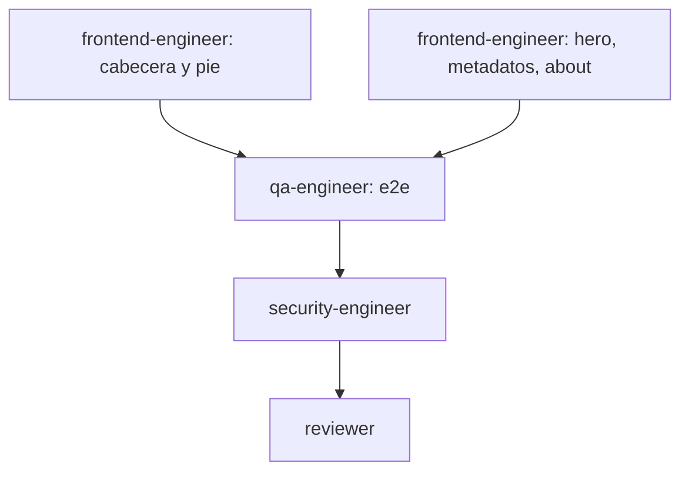

Slug: rename-brand-master-of-puppets
Iteración: iter-13

# Tasks — iter-13 rebrand «Master of the Puppets»

| ID | Tarea | Agente | Skill | Depende de | Cubre | Validación |
|---|---|---|---|---|---|---|
| T-01 | Cambiar wordmark, aria-label de la cabecera y copyright del pie | frontend-engineer | create-catalog-ui | — | RF-01, RF-02, RNF-01 | `grep -rn "IRON DECK" apps/web/components/iron-deck-header.tsx apps/web/components/iron-deck-footer.tsx` sin resultados; captura 1280×800 y 390×844 |
| T-02 | Cambiar eyebrow del hero, metadatos (layouts, producto, /about) y texto de /about | frontend-engineer | create-catalog-ui | — | RF-03, RF-04, RF-05, RF-06, RNF-01 | `npm run lint` + `npx tsc --noEmit` + `npm run build` en apps/web; `grep -rn "IRON DECK" apps/web/app apps/web/components` solo en comentarios |
| T-03 | Actualizar e2e que localizan la marca y ejecutar la suite | qa-engineer | generate-tests | T-01, T-02 | RNF-02, RNF-03 | `npx playwright test` en apps/web con 0 fallos y 0 errores de consola |
| T-04 | Security gate (Fase 7) | security-engineer | security-review | T-03 | RNF-01, RNF-03 | Veredicto APROBADO o APROBADO CON OBSERVACIONES (0 CRITICAL/HIGH) |
| T-05 | Reviewer (Fase 10) | reviewer | review-pr | T-04 | RF-01..RF-06, RNF-01..RNF-03 | Veredicto APROBAR |

## Gates

- **Fase 7 (security-engineer)**: bloquea si CRITICAL/HIGH abiertos.
- **Fase 10 (reviewer)**: bloquea si veredicto distinto de APROBAR.
- **Gate del plan**: una persona aprueba este plan antes de tocar código (DEC-002).

## Bucles

- CRITICAL/HIGH → fix → re-ejecutar security-engineer.
- CAMBIOS REQUERIDOS del reviewer → fix → re-lanzar reviewer.

## Diagrama de dependencias



```yaml
tasks:
  - id: T-01
    title: 'Cambiar wordmark, aria-label de la cabecera y copyright del pie'
    covers:
      - RF-01
      - RF-02
      - RNF-01
    depends_on: []
    verification: 'grep -rn "IRON DECK" apps/web/components/iron-deck-header.tsx apps/web/components/iron-deck-footer.tsx sin resultados; captura 1280x800 y 390x844'
  - id: T-02
    title: 'Cambiar eyebrow del hero, metadatos de layouts y producto, y texto de /about'
    covers:
      - RF-03
      - RF-04
      - RF-05
      - RF-06
      - RNF-01
    depends_on: []
    verification: 'npm run lint && npx tsc --noEmit && npm run build en apps/web; grep "IRON DECK" en apps/web/app y apps/web/components solo en comentarios'
  - id: T-03
    title: 'Actualizar e2e que localizan la marca y ejecutar la suite'
    covers:
      - RNF-02
      - RNF-03
    depends_on:
      - T-01
      - T-02
    verification: 'npx playwright test en apps/web con 0 fallos y 0 errores de consola'
  - id: T-04
    title: 'Security gate Fase 7 sobre el rebrand'
    covers:
      - RNF-01
      - RNF-03
    depends_on:
      - T-03
    verification: 'reports/iter-13/security-engineer.md con 0 CRITICAL/HIGH abiertos'
  - id: T-05
    title: 'Reviewer Fase 10 del rebrand'
    covers:
      - RF-01
      - RF-02
      - RF-03
      - RF-04
      - RF-05
      - RF-06
      - RNF-01
      - RNF-02
      - RNF-03
    depends_on:
      - T-04
    verification: 'reports/iter-13/reviewer.md con veredicto APROBAR'
```
