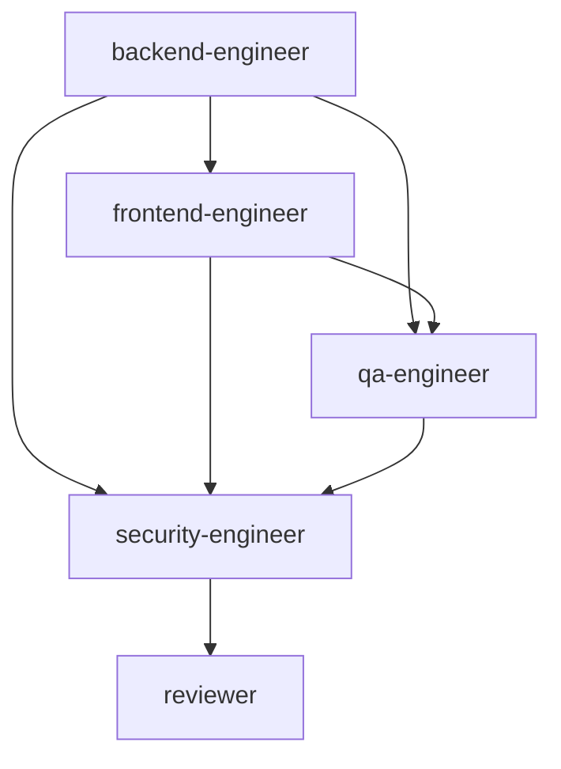

# Tasks — iter-12 `/tours`

| ID | Tarea | Agente | Skill | Depende de | Entregable | Validación |
|---|---|---|---|---|---|---|
| T1 | Implementar área backend `tours` | backend-engineer | generate-product-api | — | apps/api/src/{types,data,routes}/tours.ts + tests/tours.test.ts + registro en app.ts | `npm test` verde + `npx tsc --noEmit` exit 0 |
| T2 | Implementar UI área `/tours` + créditos | frontend-engineer | create-catalog-ui | T1 (shape API) | apps/web/{lib,app,components} + credits.ts + link header + public/covers/tours/* (placeholders OK si no hay imágenes) | `npm run lint` + `npx tsc --noEmit` + `npm run build` |
| T3 | Test plan + tests + smoke | qa-engineer | generate-tests | T1, T2 | reports/iter-12/qa-test-plan.md + e2e/tours.spec.ts + ejecución contra Docker | vitest + playwright contra Docker verde |
| T4 | Security gate (Fase 7) | security-engineer | security-review | T1, T2, T3 | reports/iter-12/security-engineer.md | Veredicto APROBADO o APROBADO CON OBSERVACIONES (0 CRITICAL/HIGH) |
| T5 | Reviewer (Fase 10) | reviewer | review-pr | T4 | reports/iter-12/reviewer.md | Veredicto APROBAR |

## Gates

- **Fase 7 (security-engineer)**: bloquea si CRITICAL/HIGH abiertos.
- **Fase 10 (reviewer)**: bloquea si veredicto != APROBAR.
- **Fase 11 (humano)**: aprobación final.

## Bucles

- CRITICAL/HIGH → fix → re-ejecutar security-engineer.
- CAMBIOS REQUERIDOS del reviewer → fix → re-lanzar reviewer.

## Diagrama de dependencias

